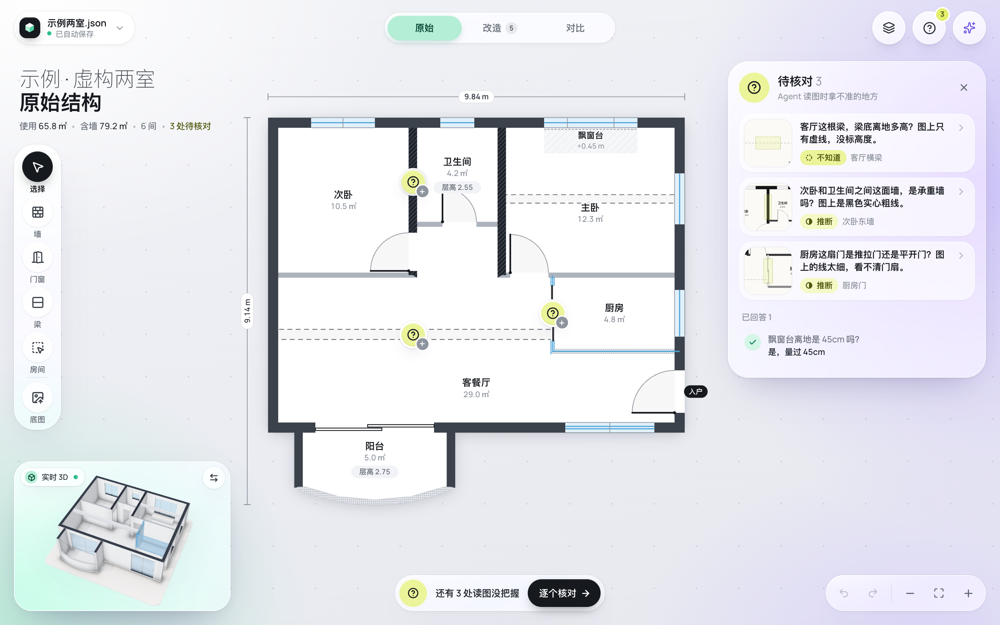
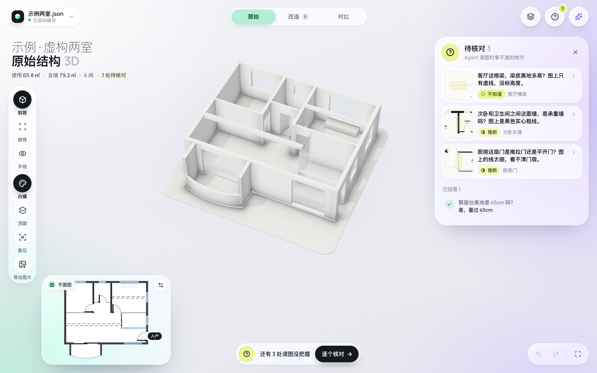
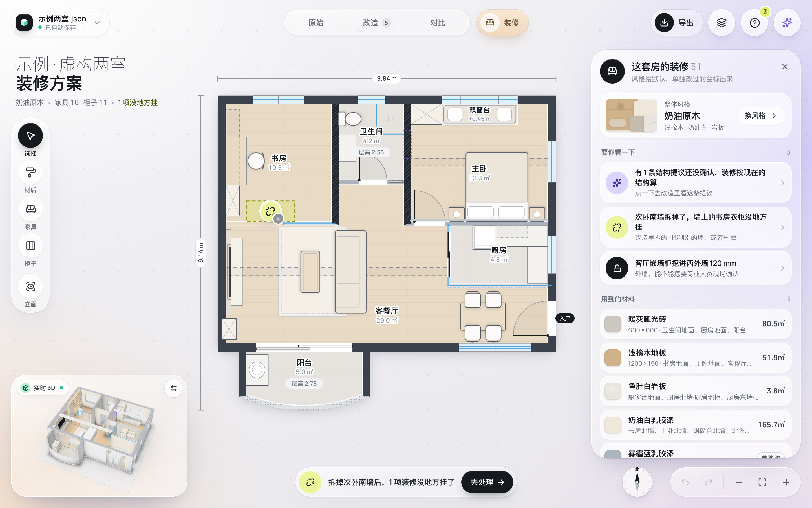
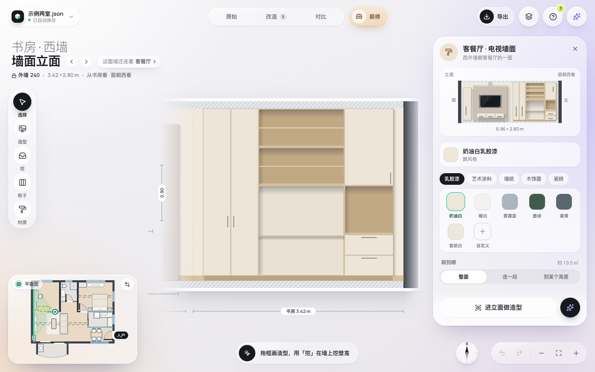

<picture>
  <source media="(prefers-color-scheme: dark)" srcset="assets/logo/try-lockup-dark.svg">
  <source media="(prefers-color-scheme: light)" srcset="assets/logo/try-lockup-light.svg">
  
</picture>

# try-your-home · 改改你的家

**v0.9.3 预览版**。一个在浏览器里编辑户型结构、比较改造想法、预览装修布置的本地工具。装修部分还在迭代。

源码公开，非商业免费使用。[English](README.en.md)

它用于整理自己的想法、核对尺寸和沟通方案。**不是施工图，也不能据此判断承重结构或拆墙是否可行**；结构、管井、外墙等改动需要现场专业确认。装修材质、家具与工程量是预览和粗估，不是施工或采购依据。

## 能做什么

- 结构阶段：载入方案 JSON 或户型底图，编辑墙、门窗、梁、房间、楼层及结构构件；核对疑问、测距，在原始／改造／对比视图中查看变化。
- 装修预览：选择风格和墙地顶材料，摆放家具、柜体，查看墙面立面和 3D 平涂／白模。结构变化后检查装修构件是否仍有宿主。
- 交付：导出方案 JSON、当前视角图片、模型和改造清单 PDF；把选中构件与需求整理成「交给 Agent」文字。

下图均为自带的**虚构两室示例**。截图来自此前的功能验证，顶栏仍显示旧标志；v0.9.0 已更换名称和标志。

| 结构平面 | 结构白模 |
| --- | --- |
|  |  |

| 装修平面预览 | 墙面立面 |
| --- | --- |
|  |  |

## 怎么用

普通使用不用 clone，也不用装 Node：仓库根目录的 `try-your-home.html` 是构建好的单文件。短版说明（网页 Chat 也能读）见 [docs/USAGE.md](docs/USAGE.md)；给 Agent 看的说明见 [AGENTS.md](AGENTS.md)。

1. **下载**：在 GitHub 打开 [try-your-home.html](try-your-home.html) 的文件页，点「Download raw file」（下载原始文件）。Gitee 镜像（https://gitee.com/gevoll/try-your-home ）同理。校验值在 [SHA256SUMS](SHA256SUMS)。
2. **双击打开**：用支持 WebGL 的现代浏览器（Chrome、Edge、Safari 等）。运行时不联网。
3. **放进方案**：网页 Chat 给的一段代码，点「粘贴方案」贴进去；Agent 给的方案 JSON，在首页点「方案文件」选它或直接拖进窗口。没有方案可以先「打开示例方案」，或看下面「还没有方案？」。
4. **导入户型图当底图**：方案里带着底图会直接显示；提示「底图没找到」点「重新导入」选同一张图；没有底图就在「底图」里点「导入户型图」，用「两点定比例」对齐。
5. **看 3D、试改造、试装修**：3D 里用「斜视」「俯视」「平视」转着看；切到「改造」选中墙或门窗拆、挪、加，「对比」看前后差别；切到「装修」选材料、摆家具（还在迭代）。
6. **导出**：点顶栏全局「导出」，可以导出改造清单 PDF、方案文件 JSON、当前 3D 视角图片 PNG。

自动保存留在当前浏览器本地存储中；重要方案请另行导出 JSON 留档。

**和 Agent 实时同步**（本地服务模式）要 Node：clone 仓库、构建后运行 `node scripts/serve.mjs <方案所在目录> [端口]`，详见下文「本地服务模式」。

### 自己构建

使用 Node.js 24（本次验证为 24.21.0）与 npm，在仓库目录执行：

```sh
git clone https://github.com/ai-azhou/try-your-home.git
cd try-your-home
npm ci
npm run build
npm test
npx tsc --noEmit -p .
```

项目的 `.npmrc` 把缓存放在本目录的 `.npm-cache/`。构建会生成 `dist/index.html`、根目录 `try-your-home.html`、`SHA256SUMS` 和第三方模块／许可清单；运行时资源及许可全文均内嵌在 HTML 中。`npm run dev` 可启动本机开发服务。

## 还没有方案？

先让 AI 把户型图读成结构方案，再拿到这里看、改：

- **有能跑程序的 Agent**（Claude Code、Codex 等）：装 [see-your-home · 看见你的家](https://github.com/ai-azhou/see-your-home) 这个 Skill，它读图、校验、出 3D 白模和白模图，交付的 `方案.json` 直接用本工具打开。
- **只有网页 Chat**（含手机 App）：用 see-your-home 仓库 [`chat/`](https://github.com/ai-azhou/see-your-home/tree/main/chat) 里的提示词，按[使用说明](https://github.com/ai-azhou/see-your-home/blob/main/chat/guide.md)走：Chat 读出方案，你点「粘贴方案」放进本工具核对；有问题点「复制问题给 Chat」贴回去。

## 隐私

双击 HTML 的离线模式运行时零网络请求；户型图和方案只在本机，不上传到本工具的服务器，也没有远程字体或统计服务。本地服务模式会请求 `127.0.0.1` 读取、轮询和保存方案，不请求外部网络。

「交给 Agent」只生成待复制文字，不自动发送。你把文字、图片或文件交给所用 Agent 后，数据如何处理取决于该 Agent 的运行方式和服务。

## 与 Skill、Agent 配合

[see-your-home · 看见你的家](https://github.com/ai-azhou/see-your-home) 是配套读图 Skill：先由 Agent 读图并写出结构方案，再在本工具里查看、核对和试改。方案 JSON 的格式标识保持 `"format": "floorplan-structure"`，与 Skill 兼容。

工具仓库带全部 [Agent 手册](docs/agent手册/README.md)：第 1–8 篇以及「相机与素材通道」附篇。装修篇目前是占位说明，装修数据契约见 [docs/format.md](docs/format.md)。

### 本地服务模式

先完成安装和构建，再运行：

```sh
node scripts/serve.mjs <方案目录> [端口]
# 示例（fixtures 是随附的公开示例目录）：
node scripts/serve.mjs fixtures 5180
```

- 第一个参数是**目录**，不是 JSON 文件；相对路径以当前终端目录为准。目录应包含方案 JSON，以及它引用的底图文件。
- 第二个参数可省略，默认 `5180`。服务只监听 `127.0.0.1`，终端会列出可打开的 URL。
- 示例地址是 `http://127.0.0.1:5180/?plan=example-v2.json`。`plan` 是相对于方案目录的文件名，中文或空格需作 URL 编码。
- 页面每约 2 秒检查文件变化；Agent 保存后，页面按本地改动／冲突状态决定更新或提示。界面「保存」可写回目录中已经存在的 JSON，遇到冲突或无效数据会拒绝覆盖。
- 服务使用 `dist/index.html`，关闭终端中的服务可按 Ctrl+C。

### 「交给 Agent」那段文字

在工具里选中需要讨论的墙、门窗或装修构件，打开「交给 Agent」，写下需求，复制生成的文字并粘给 Agent。文字包含方案位置、当前模式、构件 id 与尺寸、待确认改造和用户原话。Agent 应先读手册，再修改对应方案。

服务模式能提供方案完整路径；直接打开 HTML 时通常只有文件名，需要另行告诉 Agent 文件位置。修改前保留方案备份。完整交接样例和操作约定见 [工具连接](docs/agent手册/工具连接.md)。

## 已知局限

- 尚未在 Windows 上验证；浏览器、显卡、系统字体差异仍需实际测试。
- 装修部分还在迭代，材料与尺寸是预览和粗估；后续工作见 [ROADMAP.md](ROADMAP.md)。
- 装修端到端测试的双击进入立面步骤曾有时序不稳定；本预览版发布准备未重新执行浏览器 e2e。

## 许可、反馈与联系

作者：**你的AI阿舟**。

自有代码采用 [PolyForm Noncommercial 1.0.0](LICENSE)，文档、示例和图片采用 [CC BY-NC-SA 4.0](LICENSE-docs.md)；商用需要另行书面授权，见 [COMMERCIAL.md](COMMERCIAL.md)。第三方组件保留原许可，详见自动生成的 [THIRD-PARTY-NOTICES.md](THIRD-PARTY-NOTICES.md)。

欢迎提 issue，暂不接受外部代码贡献，见 [CONTRIBUTING.md](CONTRIBUTING.md)。反馈请使用虚构或脱敏示例。

- 邮箱：azhou.ai@proton.me
- 微信：ai_azhou
- 小红书：@你的AI阿舟（azhou_ai）
- 抖音：@你的AI阿舟（azhou.ai）
